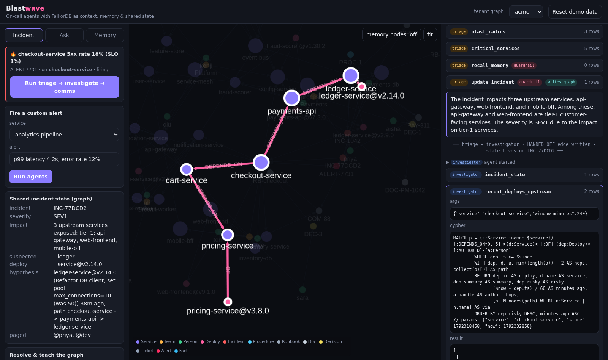
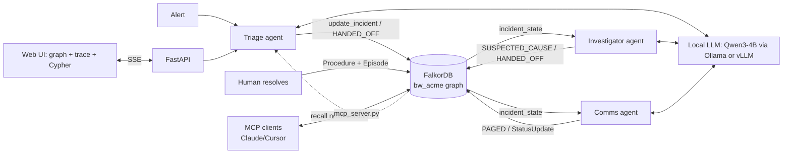
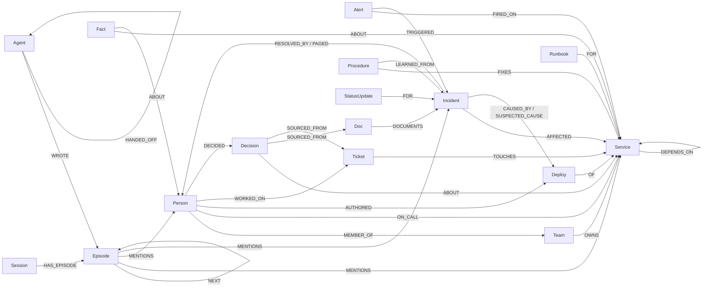

# Blastwave: on-call agents that work from the graph

**FalkorDB Graph Hacks 2026 entry.** Tracks: *Agents That Act on Connected Data*, *Agent Memory and Coordination*, *Company Brain*.

It's 3 a.m. and `checkout-service` is returning 5xx errors. The cause is a deploy to `ledger-service` 38 minutes ago, two dependency hops away. The person who fixed the same failure in March is on a different team, and the decision record explaining why the ledger pool must stay at 50 or more connections sits in an ADR nobody has opened since it was written.

Blastwave is a team of three local-LLM agents (**triage → investigator → comms**) that use **FalkorDB as their context layer**. They follow dependencies to find the root cause, page the right people, and write what they learned back into the graph so the next incident is faster. Each decision comes with the Cypher that produced it and the subgraph it relied on.

> Demo video: _<add YouTube link>_  ·  Runs fully local: FalkorDB + Qwen3-4B (Ollama or vLLM) on an 8 GB laptop GPU.



---

## What the graph does (it isn't a side store)

| The agent needs to… | FalkorDB does it with |
|---|---|
| Know what breaks if X fails | variable-length upstream traversal `(:Service)-[:DEPENDS_ON*1..6]->(x)` |
| Find a root cause several hops from the symptom | downstream traversal joined to `Deploy` nodes in a time window |
| Know which services matter structurally | `algo.pageRank`, `algo.betweenness` (single points of failure), `algo.labelPropagation` (clusters) |
| Explain a path | `shortestPath(...)` returned to the UI and highlighted |
| Remember how this was fixed last time | `Procedure`/`Incident` nodes (procedural + episodic memory) that persist across sessions |
| Hand work to another agent | the shared `Incident` node + `(:Agent)-[:HANDED_OFF]->(:Agent)` edges. Agents get **only an incident id** and read state back from the graph |
| Know who to wake up, and why | on-call + team + manager, plus experts ranked by `WORKED_ON / RESOLVED_BY / AUTHORED` evidence |
| Justify a fix | `(:Decision)-[:SOURCED_FROM]->(:Doc|:Ticket)` decision tracing |
| Keep tenants apart | **one graph per tenant** in one FalkorDB instance (`bw_acme`, `bw_globex`) |

The LLM never writes Cypher. It picks from **19 typed graph tools** (parameterized Cypher). A small 4B model chooses which tools to call, and the graph supplies the facts. If the model skips a check it was required to run (small models do), a **guardrail** runs that tool with arguments derived from the graph and feeds the result back. The UI marks those steps, so you can always see what the model decided and what the guardrail filled in.

## Architecture



## Graph data model



**Memory types**
- **Episodic**: `Session → Episode (NEXT-chained) → MENTIONS → entity`. Every agent turn and chat message. Chat sessions reload their history from here.
- **Semantic**: `Fact -[:ABOUT]-> entity`. Durable facts the agent is told (`remember` tool).
- **Procedural**: `Procedure -[:FIXES]-> Service`, `-[:LEARNED_FROM]-> Incident`, with a `uses` counter. Resolving an incident creates a procedure or reinforces an existing one.
- **Shared state**: the open `Incident` node (severity, impact, hypothesis, `SUSPECTED_CAUSE`, `PAGED`) plus `HANDED_OFF {incident, note}` edges.

Seed data (`blastwave/seed.py`): a synthetic fintech, **Acme**, with 29 services, 6 teams, 20 people, 13 deploys, 4 past incidents, runbooks, ADRs, tickets and decisions, plus a tiny **Globex** tenant to show isolation.

## The Cypher behind the product

All queries live in [`blastwave/tools.py`](blastwave/tools.py) and [`blastwave/memory.py`](blastwave/memory.py). These are the key ones:

**Blast radius** (what breaks if `$service` fails):
```cypher
MATCH p = (up:Service)-[:DEPENDS_ON*1..6]->(s:Service {name: $service})
WITH up, min(length(p)) AS hops, collect(p)[0] AS path
OPTIONAL MATCH (t:Team)-[:OWNS]->(up)
RETURN up.name AS service, up.tier AS tier, t.name AS team, hops, [n IN nodes(path) | n.name] AS via
ORDER BY hops, tier
```

**Root-cause candidates**: recent deploys anywhere downstream of the symptom:
```cypher
MATCH p = (s:Service {name: $service})-[:DEPENDS_ON*0..5]->(d:Service)<-[:OF]-(dep:Deploy)<-[:AUTHORED]-(a:Person)
WHERE dep.ts >= $since
WITH dep, d, a, min(length(p)) - 2 AS hops, collect(p)[0] AS path
RETURN dep.id AS deploy, d.name AS service, dep.summary AS summary, dep.risky AS risky,
       ($now - dep.ts) / 60 AS minutes_ago, a.handle AS author, hops,
       [n IN nodes(path) WHERE n:Service | n.name] AS via
ORDER BY dep.risky DESC, minutes_ago ASC
```

**Similar past incidents** (episodic memory over the dependency neighbourhood):
```cypher
MATCH (s:Service {name: $service})-[:DEPENDS_ON*0..4]->(n:Service)<-[:AFFECTED]-(i:Incident)
WHERE i.status = 'resolved'
OPTIONAL MATCH (i)-[:CAUSED_BY]->(d:Deploy)-[:OF]->(ds:Service)
OPTIONAL MATCH (i)-[:RESOLVED_BY]->(p:Person)
OPTIONAL MATCH (doc:Doc)-[:DOCUMENTS]->(i)
RETURN i.id, i.title, i.summary, ds.name AS root_cause_service, p.handle AS resolved_by,
       doc.id AS postmortem, count(DISTINCT n) AS overlap
ORDER BY overlap DESC
```

**Procedural memory**:
```cypher
MATCH (s:Service {name: $service})-[:DEPENDS_ON*0..3]->(t:Service)<-[:FIXES]-(p:Procedure)
OPTIONAL MATCH (p)-[:LEARNED_FROM]->(i:Incident)
RETURN DISTINCT p.id, p.title, t.name AS fixes, p.steps, p.uses, p.learned_by, i.id AS learned_from
ORDER BY p.uses DESC
```

**Who knows this system** (the brief's example query, extended with evidence):
```cypher
MATCH (s:Service {name: $service})
MATCH (p:Person)-[r:WORKED_ON|RESOLVED_BY|AUTHORED]-(x)-[:TOUCHES|AFFECTED|OF]->(s)
RETURN p.handle, p.name, collect(DISTINCT type(r)) AS evidence,
       collect(DISTINCT coalesce(x.id, x.title)) AS via, count(*) AS score
ORDER BY score DESC LIMIT 5
```

**Decision tracing**:
```cypher
MATCH (d:Decision)-[:ABOUT]->(s:Service {name: $service})
OPTIONAL MATCH (o:Person)-[:DECIDED]->(d)
OPTIONAL MATCH (d)-[:SOURCED_FROM]->(src)
RETURN d.id, d.title, o.handle AS decided_by, collect(DISTINCT {id: src.id, title: src.title}) AS sources
```

**Graph algorithms as agent tools**:
```cypher
CALL algo.pageRank('Service', 'DEPENDS_ON') YIELD node, score RETURN node.name, score ORDER BY score DESC LIMIT $k
CALL algo.betweenness({nodeLabels: ['Service'], relationshipTypes: ['DEPENDS_ON']}) YIELD node, score RETURN node.name, score ORDER BY score DESC LIMIT $k
CALL algo.labelPropagation({nodeLabels: ['Service'], relationshipTypes: ['DEPENDS_ON']}) YIELD node, communityId RETURN communityId, collect(node.name)
MATCH (a:Service {name: $source}), (b:Service {name: $target})
WITH shortestPath((a)-[:DEPENDS_ON*1..8]->(b)) AS p RETURN [n IN nodes(p) | n.name], length(p)
```

**Agent handoff and shared state**:
```cypher
MATCH (a:Agent {name: $src}), (b:Agent {name: $dst})
CREATE (a)-[:HANDED_OFF {incident: $iid, note: $note, ts: $ts}]->(b)

MATCH (i:Incident {id: $iid})-[:AFFECTED]->(s:Service)
OPTIONAL MATCH (al:Alert)-[:TRIGGERED]->(i)
OPTIONAL MATCH (i)-[:SUSPECTED_CAUSE]->(d:Deploy)-[:OF]->(ds:Service)
OPTIONAL MATCH (i)-[:PAGED]->(p:Person)
OPTIONAL MATCH ()-[h:HANDED_OFF {incident: $iid}]->()
RETURN i.severity, i.impact, i.hypothesis, d.id AS suspected_deploy, ds.name AS suspected_service,
       collect(DISTINCT p.handle) AS paged, collect(DISTINCT h.note) AS handoff_notes
```

**Episodic memory write** (NEXT-chained per session, linked to every entity mentioned):
```cypher
MATCH (s:Session {id: $sid})
OPTIONAL MATCH (s)-[:HAS_EPISODE]->(prev:Episode) WHERE NOT (prev)-[:NEXT]->()
CREATE (e:Episode {id: $eid, text: $text, ts: $ts, kind: $kind, agent: $agent})
CREATE (s)-[:HAS_EPISODE]->(e)
FOREACH (_ IN CASE WHEN prev IS NULL THEN [] ELSE [1] END | CREATE (prev)-[:NEXT]->(e))
WITH e UNWIND $mentions AS m
MATCH (x) WHERE (x:Service OR x:Person OR x:Incident OR x:Deploy OR x:Procedure OR x:Decision)
            AND (x.name = m OR x.handle = m OR x.id = m)
MERGE (e)-[:MENTIONS]->(x)
```

## Setup (local, ~5 minutes)

Requirements: Docker, Python 3.11+ ([uv](https://docs.astral.sh/uv/) recommended), and a local OpenAI-compatible LLM. Ollama is the easiest option.

```bash
git clone https://github.com/<you>/blastwave && cd blastwave

# 1. FalkorDB (+ Browser on http://localhost:3000)
docker compose up -d falkordb

# 2. Local LLM: Qwen3-4B-Instruct with a 16k context
ollama pull qwen3:4b-instruct-2507-q4_K_M
ollama create blastwave-qwen -f Modelfile
#    (or vLLM: docker compose --profile llm up -d vllm  and set LLM_BASE_URL=http://localhost:8000/v1 LLM_MODEL=local)

# 3. App
uv venv && uv pip install -e ".[dev]"
cp .env.example .env   # set LLM_BASE_URL=http://localhost:11434/v1 and LLM_MODEL=blastwave-qwen for Ollama
python -m blastwave.seed
uvicorn blastwave.server:app --port 8080
# open http://localhost:8080
```

Or run everything in containers (with Ollama running on the host):
```bash
docker compose --profile app up --build
```

Any OpenAI-compatible endpoint works. Set `LLM_BASE_URL`, `LLM_MODEL` and `LLM_API_KEY`. With no LLM reachable, the agents still finish the workflow on graph guardrails alone.

### Demo script
1. **Incident tab → Run triage → investigate → comms** on `ALERT-7731`. Watch the triage agent size the blast radius, then the investigator trace `checkout-service → payments-api → ledger-service`, find `ledger-service@v2.14.0`, match `INC-1042`, and pull up `PROC-1`. The comms agent pages `@dev` (on-call) and `@priya` (resolved INC-1042). Click any trace step to replay its evidence on the graph.
2. **Resolve & teach the graph**: the procedure's `uses` counter increments, and the resolution is written as an episode.
3. Fire a **custom alert** on `payments-api`. Triage's `recall_memory` returns the previous session's episodes, so memory carries across sessions.
4. **Ask tab**: "Why must the ledger pool be ≥ 50? Show sources." follows a decision trace to an ADR, a postmortem and a ticket. Reload the page and the chat session continues from the graph.
5. Switch tenant to **globex**: a separate graph in the same FalkorDB instance, with no Acme data visible.

### MCP
The same tools are exposed over MCP, so Claude Desktop, Claude Code or Cursor can query the graph:
```bash
claude mcp add blastwave -- uv run --directory "$PWD" python -m blastwave.mcp_server
```

### Tests
```bash
docker compose up -d falkordb && pytest -q
```
The tests cover multi-hop blast radius, root cause found two hops downstream, shortest path, the algorithms, company-brain queries, tenant isolation, the full three-agent pipeline, and cross-session procedural memory.

## Repo map
```
blastwave/db.py          FalkorDB client, graph-per-tenant, result → JSON
blastwave/seed.py        synthetic Acme + Globex tenants
blastwave/tools.py       15 graph tools (parameterized Cypher + evidence subgraph)
blastwave/memory.py      memory, handoffs, 4 incident-state/action tools
blastwave/agents.py      triage → investigator → comms, tool loop + guardrails, chat agent
blastwave/server.py      FastAPI + SSE trace stream
blastwave/mcp_server.py  MCP server over the same tools
web/index.html           UI: live graph (cytoscape), trace with Cypher, memory view
```

## Why a graph?
Every question an on-call engineer asks is about connections: *what depends on this, what changed near it, who touched it, has this happened before, why is it configured this way.* In a document store, an agent would have to stitch those answers together over many calls and would probably guess wrong. In FalkorDB, each one is a single traversal that is fast enough to run on every step of the agent loop. Because the agents write their own state and memory into the same graph, the next agent and the next session start from what the previous ones learned.
